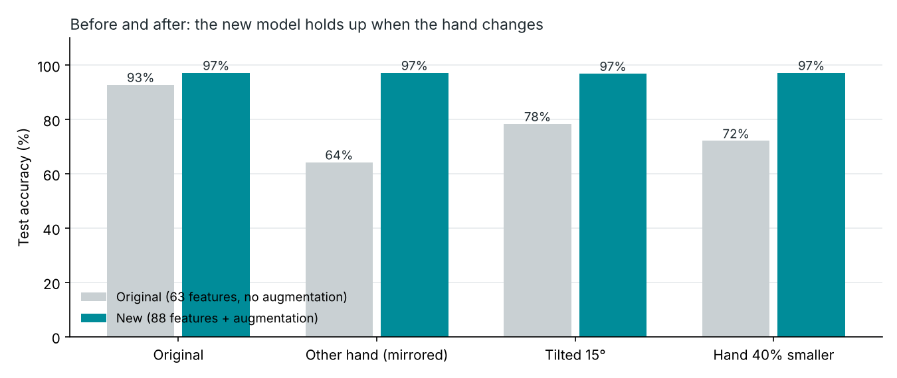

# Vani-Setu

<p align="center">
  <strong>voice-bridge</strong> — real-time ASL / ISL translation from a laptop camera
</p>

<p align="center">
  <a href="https://vani-setu.onrender.com"></a>
  <a href="https://github.com/ShadowAN-AB/Vani_Setu"></a>
</p>

<p align="center">
  
  
  
  
  
  
  
  
</p>

**Live app:** [https://vani-setu.onrender.com](https://vani-setu.onrender.com)  
Open the link → **Continue as guest** → **Start camera** (allow the webcam). The Free Render instance sleeps after idle time; the first load can take about a minute.

A laptop camera tracks one or two hands in the browser. Machine learning turns them into fingerspelled letters or whole signs, the app builds a sentence (with word prediction that can fix a misread letter), speaks it, and translates it into 25+ languages.

Day to day, run it on **localhost** at `http://127.0.0.1:5001` (`./run.sh`). The public URL is the same product over HTTPS.

---

## What's new (October 2026)

| Area | Change |
|------|--------|
| **Letter model** | 88 features instead of 63 (palm-length scaling, 10 fingertip distances, 15 joint angles); training data augmented with mirrored, tilted and jittered copies; 70 / 15 / 15 split with C and γ tuned on validation. **96.9%** test accuracy, **97.1% ± 1.6%** cross-validation. |
| **Robustness** | With the other hand the old model fell to 64.3%; the new one scores 97.2%. Tilted 15°: 78.4% → 96.9%. Hand farther away: 72.1% → 97.2%. |
| **Neural networks** | Keras MLP (Dense 128 → 64, ReLU, dropout, softmax) for letters, ASL phrases and ISL signs. Weights are exported and run with NumPy, so the server needs no TensorFlow. |
| **Two hands** | MediaPipe tracks two hands; phrase and ISL samples keep both, with their Left / Right label (181 features). |
| **Word prediction** | Noisy-channel model: word frequency × how often the classifier confuses letters, so X-E-D still suggests RED. |
| **Data** | Every sample is stored as raw landmarks with the signer's name, hand and a **Test set** flag for new-signer testing. |
| **Evaluation** | `evaluate.py`: before/after, cross-validation, learning and validation curves, PCA / t-SNE, speed. `compare_models.py`: six models on identical data. |
| **App** | Holding a sign types it once; unsure frames are ignored; the label always matches its confidence; FPS badge shows response time. |
| **Security** | The server only serves the web page and hand model (before, `users.db` and `.env` could be downloaded). Recording and retraining are local only. |
| **Clean-up** | Original hackathon CNN code moved to `legacy/` and credited. |

---

## Results

All on the same held-out test set (319 samples, 26 letters). Full report: [`reports/evaluation.md`](Sign-Language-Interpreter-using-Deep-Learning-master/Code/reports/evaluation.md).

| Test condition | First version (63 features) | Current (88 features + augmentation) |
|----------------|-----------------------------|--------------------------------------|
| Normal | 92.8% | 97.2% |
| Other hand (mirrored) | 64.3% | 97.2% |
| Tilted 15° | 78.4% | 96.9% |
| Hand 40% smaller (farther away) | 72.1% | 97.2% |



| Model (same data and features) | Test accuracy |
|--------------------------------|---------------|
| **SVM, RBF kernel** (used for letters) | **97.2%** (tuned live model: 96.9%) |
| MLP neural network | 96.2% (Keras version: 95.9%) |
| Random Forest | 96.2% |
| Logistic Regression | 95.9% |
| K-Nearest Neighbours | 95.0% |
| Decision Tree | 90.9% |

---

## Tech stack

| Layer | Tools |
|:------|:------|
| **Interface** | HTML5 · CSS3 · vanilla JavaScript · Google Fonts (Fraunces / Sora) |
| **Vision** | [MediaPipe Tasks Vision](https://ai.google.dev/edge/mediapipe/solutions/vision/hand_landmarker) (21-point Hand Landmarker in the browser) · `getUserMedia` camera |
| **Backend** | Python 3 · Flask · Flask-CORS · Gunicorn |
| **Machine learning** | scikit-learn **RBF SVM** for letters (96.9% test, Platt-scaled probabilities) · **Keras MLP** for phrases / ISL, run with NumPy · landmark augmentation · noisy-channel word prediction · matplotlib reports |
| **Accounts** | Flask-SQLAlchemy · Werkzeug password hashes · SQLite locally · optional Postgres (`DATABASE_URL`) |
| **Speech & language** | Web Speech API (speak) · deep-translator / Google Translate · offline Hindi fallback |
| **Data** | ASL Now fingerspelling landmarks (Hugging Face, MIT) + team recordings · raw 21-point landmarks · 88 features (scaled points, fingertip distances, joint angles) |
| **Run & ship** | `run.sh` on localhost · Render (HTTPS) · GitHub · python-dotenv |

```text
Browser (HTML / CSS / JS + MediaPipe, up to 2 hands)
        │  21 landmarks per hand (never video)
        ▼
Flask API ──► SVM, 88 features (Spell)
        │ ──► MLP, 181 features (Phrase / ISL, once trained; rules until then)
        │ ──► word prediction (/api/suggest)
        ├── SQLite / Postgres   (login)
        └── Translate + Speak
```

---

## What it does

| Mode | What happens |
|------|----------------|
| **Spell** | Fingerspelling A–Z. An RBF **SVM** classifies 88 landmark features (**96.9%** test accuracy, 97.1% ± 1.6% 5-fold CV, and about 97% when the hand is mirrored, tilted or farther away). |
| **Phrase** | Whole signs such as Hello, Yes, OK. A Keras **MLP neural network** on both hands (181 features) once phrase samples are recorded and trained; hand-written finger rules until then. |
| **ISL** | Indian signs (Namaste, Thank You, Water, Help, …), one or two hands. Same neural network approach with its own model; rules as the fallback. Not a certified ISL lexicon. |
| **Practice** | The app prompts a letter and scores your attempts. |
| **Translate / Speak** | English sentence → 25+ languages, plus browser speech. Hindi has an offline fallback if Google Translate is down. |

Also included:

- Email + password login (hashed passwords in a local **SQLite** file)
- Live confidence bar in Spell mode
- Word prediction while spelling: a noisy-channel model (word frequencies × the letter model's confusion matrix) can fix a misread letter, e.g. X-E-D → RED
- Record dataset + **Retrain model** from the browser
- Sign Guide overlay

---

## How it works

1. You create an account or sign in.
2. The browser camera + **MediaPipe Hand Landmarker** finds 21 landmarks on one hand. Tracking stays on the device.
3. Spell mode sends the 21 landmarks to Flask (`/api/classify`), which computes 88 features and returns the most likely letter, its probability and the top 3. Frames below the confidence threshold picked during training vote “unsure”, and a 14-frame vote reduces flicker.
4. Phrase / ISL modes match poses with rules unless you record your own phrase samples.
5. You assemble a sentence, speak it, or translate it.

Login does **not** need MongoDB. Accounts are stored in `Sign-Language-Interpreter-using-Deep-Learning-master/Code/users.db`. On a host you can set `DATABASE_URL` for Postgres instead.

---

## Requirements

- macOS or Linux (Windows: use the `.bat` launchers under `Sign-Language-Interpreter-using-Deep-Learning-master/`)
- **Python 3.10+** (`python3 --version`)
- A laptop **camera**
- **Internet** the first time (pip packages + MediaPipe JS from `cdn.jsdelivr.net`)
- Port **5001** free — on macOS, port 5000 is often taken by AirPlay

---

## Run on localhost (recommended)

From this repository root (`Vani-Setu/`):

```bash
chmod +x run.sh
./run.sh
```

`run.sh` creates a virtualenv if needed, installs `Code/requirements_web.txt`, and starts Flask.

Open **http://127.0.0.1:5001**

1. **Create account** (email + password, at least 6 characters).
2. Later visits: **Sign in**.
3. Click **Start camera** and allow the browser.
4. Use **SPELL** for letters, **PHRASE** or ISL for words.
5. **Logout** when finished (this also stops the camera LED).

Stop the server with `Ctrl+C` in the terminal.

### Manual start (if you do not use `run.sh`)

```bash
cd Sign-Language-Interpreter-using-Deep-Learning-master/Code
python3 -m venv .venv
source .venv/bin/activate
pip install -r requirements_web.txt
PORT=5001 python server.py
```

### Windows

Double-click `Sign-Language-Interpreter-using-Deep-Learning-master/RUN_VANI_SETU.bat`  
(or `QUICK_START.bat`). The default port on those scripts may be 5000.

---

## First-time files

| File | In git? | What happens |
|------|---------|----------------|
| `Code/models/sign_svm.joblib` | Yes | Spell-mode SVM bundle (model, feature version, threshold). Present after `git clone`. |
| `Code/hand_landmarker.task` | No (~7.5 MB) | MediaPipe hand model. The server **downloads it on first run** if missing. |

`users.db` stays local and gitignored. A hosted demo uses guest login so it does not depend on that file.

Keep this project folder for the viva. GitHub now has the letter model; you do not need a USB copy of `sign_svm.joblib`.

---

## Public URL

**Live:** [https://vani-setu.onrender.com](https://vani-setu.onrender.com)

Localhost does not change. To redeploy after a code push:

1. Push `main` to GitHub (Render auto-builds).
2. Or [render.com](https://render.com) → **New** → **Web Service**:
   - Build: `pip install -r requirements.txt`
   - Start: `bash start.sh`
   - `AUTH_MODE=guest`
3. Open the `https://` URL → **Continue as guest** → **Start camera**.

Full notes: [DEPLOY.md](DEPLOY.md). Free Render apps sleep after idle time; the first hit after sleep can take about a minute.

---

## Health check

With the server running:

```bash
curl -s http://127.0.0.1:5001/api/health
```

`ready_for_demo: true` means the classifier and `hand_landmarker.task` are both present.

---

## Coming back after a break

```bash
cd /path/to/Vani-Setu
./run.sh
```

Then open **http://127.0.0.1:5001**. Accounts in `users.db` stay on disk. Nothing expires. If Python on the Mac was upgraded, `./run.sh` recreates `.venv`.

---

## Auth options

Default is **password**. Copy `Code/.env.example` to `Code/.env` only if you need to change this.

| `AUTH_MODE` | Behaviour |
|-------------|-----------|
| `password` | Email + password (SQLite). **Default.** |
| `guest` | Password login plus **Continue as guest**. |
| `otp` | Email / terminal 6-digit code (needs SMTP for real email). |
| `none` | Skip the login screen. |

Hosted deploy notes (Render, HTTPS, guest login): see [DEPLOY.md](DEPLOY.md).

---

## Retrain / record

- **Record dataset** in the UI saves raw landmarks with the signer's name to `Code/dataset/recordings/samples.csv` (letters and phrases, kept apart). Tick **Test set** to hold a person's samples out for new-signer testing. Recording and retraining work on localhost only.
- **Retrain model** in the UI trains the SVM and reloads it without restarting Flask.
- From a terminal:

```bash
cd Sign-Language-Interpreter-using-Deep-Learning-master/Code
.venv/bin/python train_classifier.py    # train + reports (70/15/15 split, augmentation, grid search)
.venv/bin/python compare_models.py      # six classifiers on the same data
.venv/bin/python evaluate.py            # before/after, CV, learning + validation curves, PCA/t-SNE, speed
.venv/bin/pip install -r requirements_train.txt   # TensorFlow, only for the neural networks
.venv/bin/python nn/train_mlp.py --kind letter    # MLP vs SVM on letters (also: --kind phrase / isl)
```

Reports land in `Code/reports/`: `metrics.json`, `evaluation.md`, `model_comparison.md` and the figures.

---

## Project layout

```
Vani-Setu/
├── README.md                          ← this file
├── run.sh                             ← Mac / Linux localhost launcher (port 5001)
├── start.sh / Procfile / render.yaml  ← public host (Render / Railway)
├── DEPLOY.md                          ← localhost vs Render
├── DEMO_AND_VIVA.md                   ← demo checklist and viva talking points
└── Sign-Language-Interpreter-using-Deep-Learning-master/
    ├── README.md                      ← original HackUNT-19 project
    ├── DOCUMENTATION.md               ← longer architecture notes
    └── Code/
        ├── index.html                 ← UI + MediaPipe
        ├── server.py                  ← Flask APIs
        ├── models_user.py             ← User table (SQLite / Postgres)
        ├── data.py                    ← raw landmark storage (dataset + recordings)
        ├── features.py                ← 88 landmark features (v2), 63 (v1)
        ├── augment.py                 ← mirror / rotate / jitter augmentation
        ├── build_dataset.py           ← ASL Now JSON → asl_now_landmarks.csv
        ├── signs.py                   ← phrase / ISL rules + Hindi fallback
        ├── train_classifier.py        ← SVM trainer
        ├── compare_models.py          ← classifier benchmark
        ├── evaluate.py                ← evaluation report
        ├── suggest.py                 ← noisy-channel word prediction
        ├── nn/train_mlp.py            ← Keras MLP (letters / phrases / ISL)
        ├── nn/numpy_mlp.py            ← runs the exported MLP with NumPy on the server
        ├── requirements_web.txt
        ├── .env.example
        ├── dataset/                   ← asl_now_landmarks.csv, recordings/, guides
        ├── reports/                   ← metrics, evaluation, figures
        └── models/sign_svm.joblib     ← trained letter SVM (in git)
    └── legacy/                        ← original HackUNT-19 CNN code (unused, credited)
```

---

## Dataset

Spell-mode letters come from **ASL Now Fingerspelling** landmarks  
([AxelS27/asl-now-fingerspelling](https://huggingface.co/datasets/AxelS27/asl-now-fingerspelling), MIT), stored as raw landmarks in `Code/dataset/asl_now_landmarks.csv` (2,122 samples, 26 letters).

See `Code/dataset/DATASET_SOURCE.md` and `RECORDING_GUIDE.md`.

---

## Honest limits

- One hand, mostly **static** poses. Motion letters **J** and **Z** are weak.
- Spell ML is **ASL fingerspelling**, not a full sign-language corpus.
- ISL in the app is a **classroom approximation**.
- Phrase mode is rule-based until you record phrase samples.
- Browser camera works on `http://127.0.0.1` but **needs HTTPS** on a public URL.
- This is a demo, not a production account system (session is `sessionStorage` after login).

---

## More docs

- [DEMO_AND_VIVA.md](DEMO_AND_VIVA.md) — what to show an examiner
- [DEPLOY.md](DEPLOY.md) — guest mode, skip login, Gmail OTP, Postgres
- [Sign-Language-Interpreter-using-Deep-Learning-master/DOCUMENTATION.md](Sign-Language-Interpreter-using-Deep-Learning-master/DOCUMENTATION.md) — older architecture write-up
- Original hackathon app (CNN / OpenCV, not the web demo): [Sign-Language-Interpreter-using-Deep-Learning-master/README.md](Sign-Language-Interpreter-using-Deep-Learning-master/README.md)

---

## Credits

- **Starting point:** this repository began from [Sign Language Interpreter using Deep Learning](https://github.com/harshbg/Sign-Language-Interpreter-using-Deep-Learning) by Harsh Gupta (HackUNT-19, 2019, MIT licence), which classified hand images with a Keras CNN. Vani-Setu replaced that pipeline; the original files are kept, unused, in `Sign-Language-Interpreter-using-Deep-Learning-master/legacy/`.
- **Hand tracking:** [MediaPipe Hand Landmarker](https://developers.google.com/edge/mediapipe/solutions/vision/hand_landmarker) (Google).
- **Letter dataset:** [ASL Now Fingerspelling Landmarks](https://huggingface.co/datasets/AxelS27/asl-now-fingerspelling) by AxelS27 (MIT licence).
- **Word frequencies:** derived from [wordfreq](https://github.com/rspeer/wordfreq) by Robyn Speer (word list data CC BY-SA 4.0), in `Code/dataset/word_frequencies.csv`.
- **Team:** Abdullah Naseem, Bhanu Satwik, Manoj Kumar K (CSET, Bennett University), guided by Dr. Mohd Anas.
