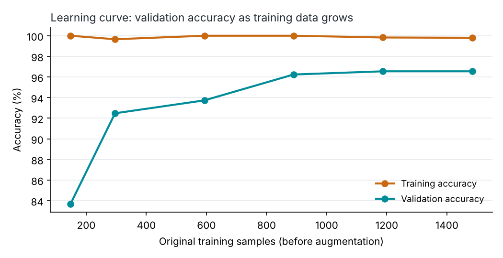
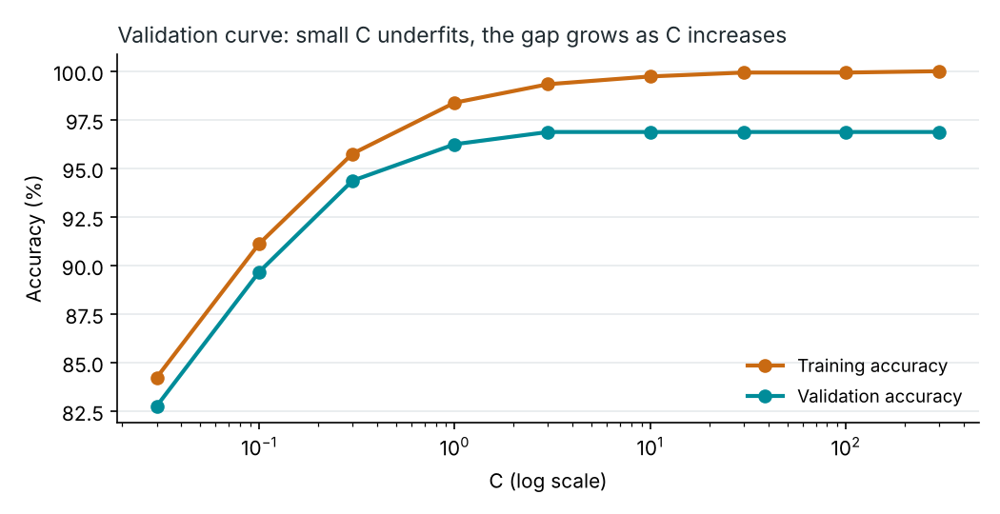
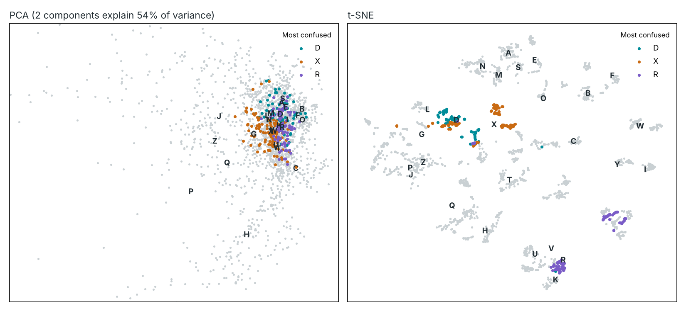

# Evaluation report

Split: 1484 train / 319 validation / 319 test (stratified, seed 42); 0 new-signer test samples. SVM with C = 10 throughout so setups are comparable.

## 1. Before and after (test accuracy)

| Setup | Original | Other hand (mirrored) | Tilted 15° | Hand 40% smaller |
|---|---|---|---|---|
| Original (63 features, no augmentation) | 92.8% | 64.3% | 78.4% | 72.1% |
| 63 features + augmentation | 94.0% | 94.4% | 93.4% | 82.5% |
| 88 features, no augmentation | 95.6% | 84.0% | 93.1% | 95.6% |
| New (88 features + augmentation) | 97.2% | 97.2% | 96.9% | 97.2% |

## 2. Cross-validation

5-fold stratified CV on train + validation, augmenting inside each fold: **97.1% ± 1.6%** (folds: 98.6%, 98.1%, 98.3%, 95.3%, 95.0%).

## 3. Learning curve

| Training samples | Training accuracy | Validation accuracy |
|---|---|---|
| 148 | 100.0% | 83.7% |
| 296 | 99.7% | 92.5% |
| 593 | 100.0% | 93.7% |
| 890 | 100.0% | 96.2% |
| 1187 | 99.8% | 96.5% |
| 1484 | 99.8% | 96.5% |

## 4. Validation curve over C

| C | Training accuracy | Validation accuracy |
|---|---|---|
| 0.03 | 84.2% | 82.8% |
| 0.1 | 91.1% | 89.7% |
| 0.3 | 95.8% | 94.4% |
| 1 | 98.4% | 96.2% |
| 3 | 99.3% | 96.9% |
| 10 | 99.7% | 96.9% |
| 30 | 99.9% | 96.9% |
| 100 | 99.9% | 96.9% |
| 300 | 100.0% | 96.9% |

## 5. PCA and t-SNE

The first two principal components explain 54% of the variance. D, X and R are highlighted because they are the most confused letters.

## 6. Speed

Features: 0.34 ms per frame. Features + SVM probabilities: 1.08 ms per frame (2684 support vectors).

## 7. New signers

No new-signer samples yet. Record them in the app with **Test set** ticked (see dataset/RECORDING_GUIDE.md).
