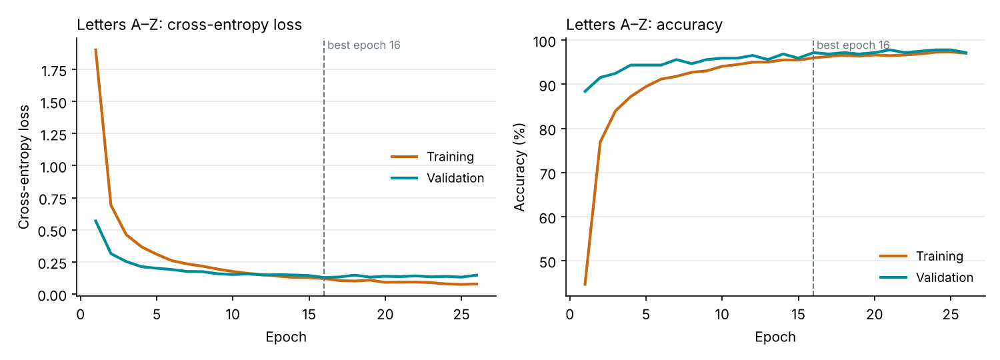

# Neural network (MLP): Letters A–Z

Architecture: 88 inputs → Dense 128 (ReLU) → Dropout 0.3 → Dense 64 (ReLU) → Dropout 0.3 → Dense 26 (softmax); 21,338 parameters.
Adam (learning rate 0.001), cross-entropy loss, batch 64, early stopping after 26 epochs (best epoch 16), 13.1 s on CPU.

| Set | Samples | Accuracy |
|---|---|---|
| Validation | 319 | 97.2% |
| Test | 319 | 95.9% (macro F1 0.961) |

SVM on the same test samples: 96.9% (macro F1 0.972).

Runs in NumPy on the server in 0.0381 ms per prediction; confidence threshold 0.75.



```
              precision    recall  f1-score   support

           A      1.000     0.900     0.947        10
           B      0.909     1.000     0.952        10
           C      1.000     0.875     0.933         8
           D      0.846     1.000     0.917        11
           E      1.000     1.000     1.000         9
           F      1.000     1.000     1.000         9
           G      1.000     1.000     1.000        14
           H      1.000     0.900     0.947        10
           I      1.000     1.000     1.000        10
           J      1.000     1.000     1.000        14
           K      1.000     0.900     0.947        10
           L      1.000     1.000     1.000        13
           M      0.929     1.000     0.963        13
           N      1.000     1.000     1.000        13
           O      1.000     0.933     0.966        15
           P      1.000     1.000     1.000        11
           Q      0.938     1.000     0.968        15
           R      0.800     0.727     0.762        11
           S      0.929     1.000     0.963        13
           T      1.000     1.000     1.000        10
           U      1.000     0.875     0.933        16
           V      0.857     1.000     0.923        12
           W      1.000     1.000     1.000        11
           X      0.938     0.938     0.938        16
           Y      1.000     1.000     1.000        12
           Z      0.913     0.913     0.913        23

    accuracy                          0.959       319
   macro avg      0.964     0.960     0.960       319
weighted avg      0.961     0.959     0.959       319

```
